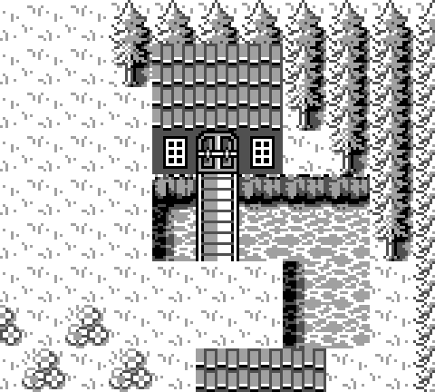

# Game Boy Emulator (C++ / Qt)

[](https://github.com/jchacker5/GameboyEmulator/actions/workflows/ci.yml)

The first stages of a Nintendo Game Boy emulator in C++17, with a Qt 6 window. It was built for
COMP 406 (Computer Architecture) at Bridgewater State University in spring 2024. It runs Game Boy
machine code on a Z80-family CPU core and renders the background layer from video memory the same
way the real hardware does.



## What it does

**CPU execution (Part 1).** It loads a ROM into the address space and drives the CPU core with
`memoryRead` / `memoryWrite` callbacks from the `0x100` entry point until `HALT`. It also prints a
per-instruction trace of PC, mnemonic and registers. The bundled test ROM sums 6+5+4+3+2+1 in a loop
and halts with `A=21` after 21 instructions.

**Background tile renderer (Part 2).** It turns 8 KB of video RAM into the 160x144 screen:
1. Apply the `SCX`/`SCY` scroll, wrapping at 256 pixels.
2. Find the 8x8 tile in one of the two 32x32 tile maps (`0x1800` / `0x1C00`).
3. Find the tile data. Tileset 1 uses unsigned indices from `0x0000`. Tileset 0 uses signed indices
   around `0x1000`.
4. Rebuild the 2-bit colour from the tile row's two bit-planes, then map it through the `BGP`
   palette.

## Build and run

Requires CMake 3.20+, a C++17 compiler and Qt 6 (`brew install qt` or `apt install qt6-base-dev`).

```sh
cmake -S . -B build -DCMAKE_BUILD_TYPE=Release
cmake --build build
./build/gameboy                                   # trace the test ROM, then show the frame in a window
QT_QPA_PLATFORM=offscreen ./build/gameboy --quiet --png frame.png   # headless: write the frame to a PNG
```

Options: `--rom FILE`, `--vram FILE` (a VRAM snapshot), `--png OUT`, `--quiet`. CI builds on Ubuntu
and macOS, runs the test ROM headless, checks for `A=21` and uploads the rendered frame.

## Layout

| Path | What |
|---|---|
| `src/gameboy.cpp` | Emulator front end: ROM loading, memory callbacks, the CPU loop, background rendering, CLI |
| `src/Z80.cpp`, `src/Z80.h` | The CPU core (instruction decode and execute, flags, interrupts). **Provided by the course.** |
| `src/screen.cpp`, `src/screen.h` | Qt window and pixel grid. **Provided by the course** (Margaret Black); I added headless PNG export. |
| `assets/testrom.gb` | The course's test program (the 6+...+1 summation) |
| `assets/screendump.txt` | A VRAM snapshot: 8,192 bytes followed by tileset, tile map, scroll and palette |

## Not implemented yet

The course project continues past what's here. These parts are not implemented:

- **Memory map and video timing (Part 3).** Working RAM, high RAM, the I/O registers (`LCDC`, `STAT`,
  `LY`, `LYC`, `BGP`), the scanline counter, and the V-blank and LCD-STAT interrupts.
- **ROM banking (Part 4).** MBC1, which larger games such as Super Mario Land need.
- **Joypad input (Part 5).**
- **Sprites (Part 6).**

Until then it doesn't run commercial games. No commercial ROMs are distributed with this repository.

## References

- Imran Nazar, [GameBoy Emulation in JavaScript](http://imrannazar.com/GameBoy-Emulation-in-JavaScript) (graphics, memory banking)
- [Pan Docs](https://gbdev.io/pandocs/), the Game Boy hardware reference
